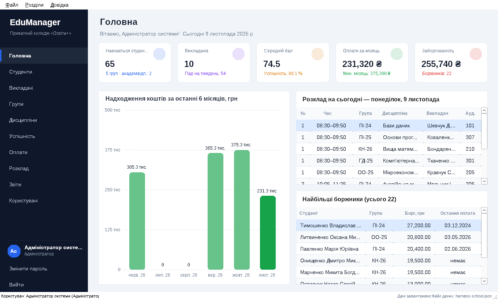
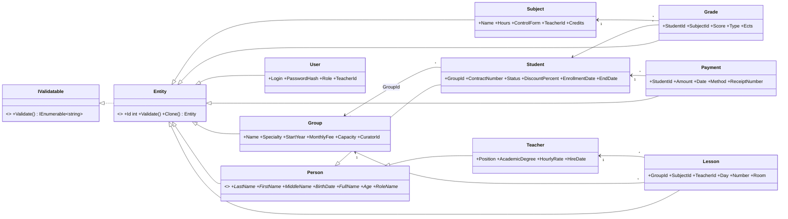
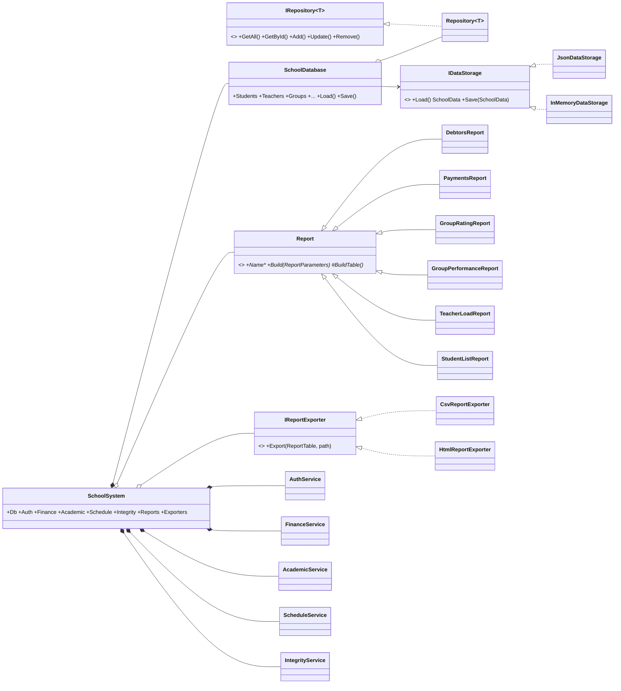
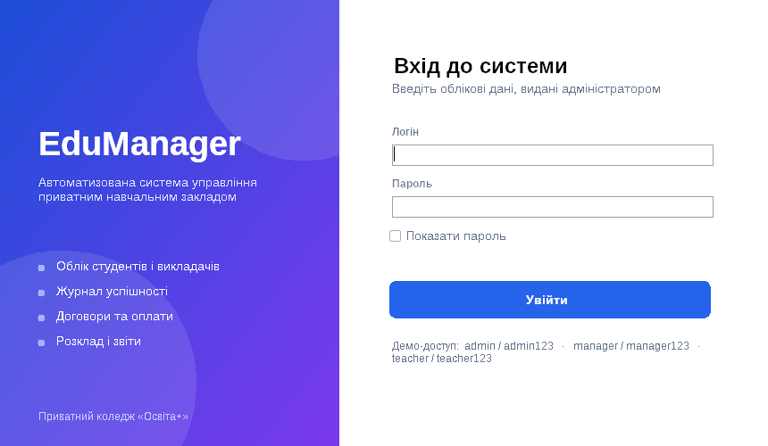
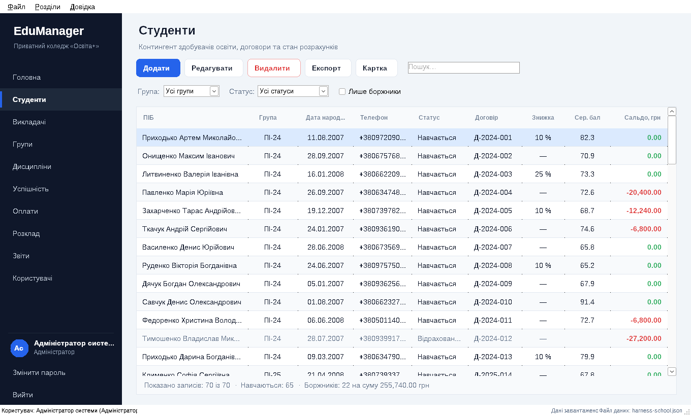
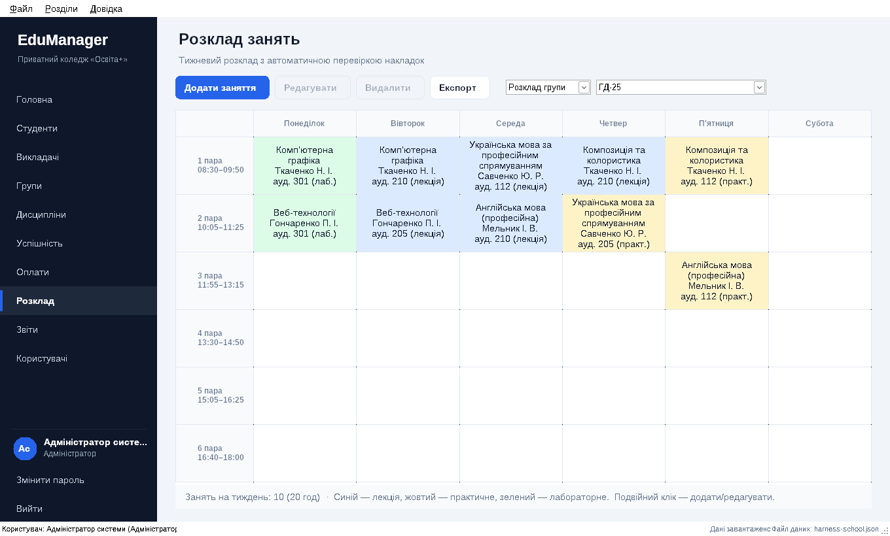
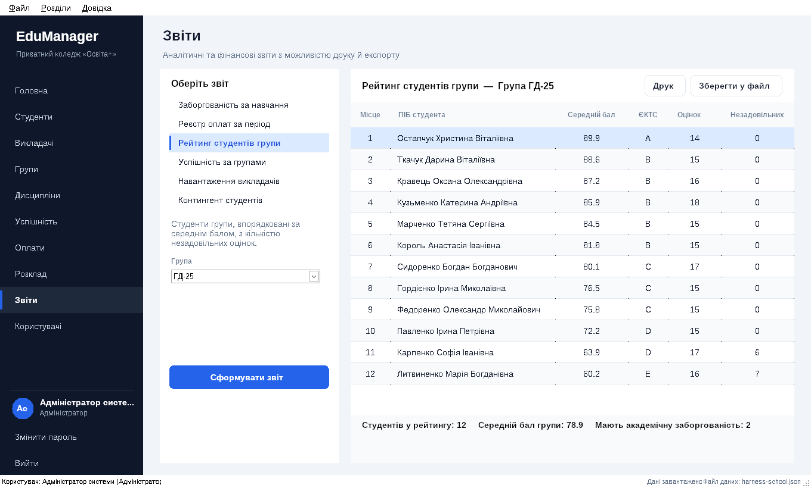
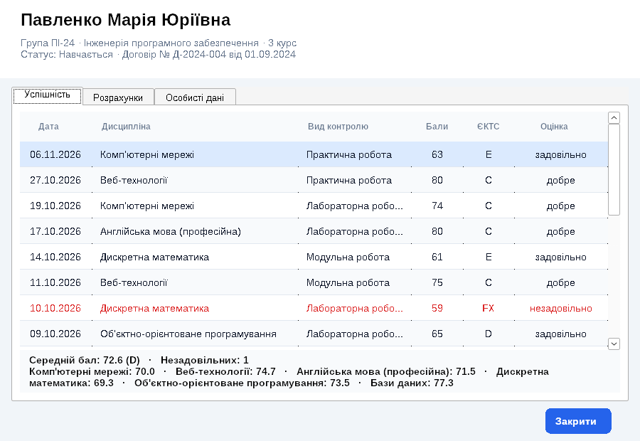
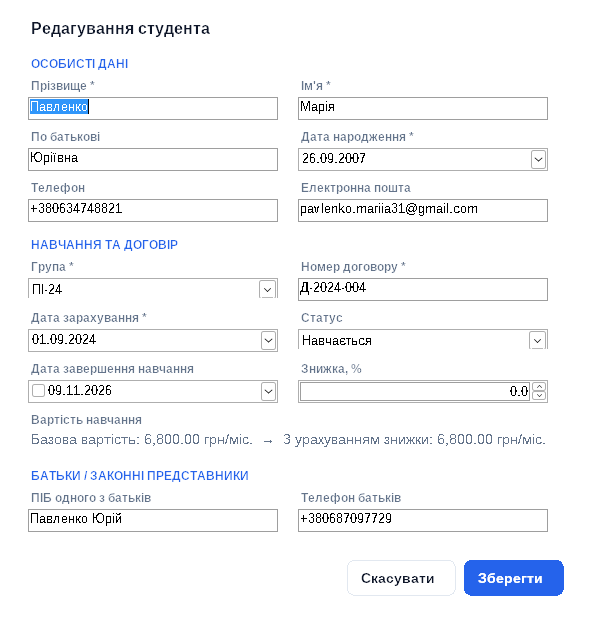

# EduManager — автоматизована система приватного навчального закладу

Курсовий проєкт з дисципліни **«Об'єктно-орієнтоване програмування»**.
Тема: **«Розробка автоматизованої системи приватного навчального закладу»**.

Настільний застосунок на **C# / .NET 8 / Windows Forms** для обліку студентів, викладачів, груп,
дисциплін, успішності, договорів і оплат за навчання, розкладу занять та формування звітів.



---

## Зміст

1. [Можливості](#можливості)
2. [Запуск](#запуск)
3. [Ролі та облікові записи](#ролі-та-облікові-записи)
4. [Архітектура](#архітектура)
5. [Принципи ООП у проєкті](#принципи-ооп-у-проєкті)
6. [Діаграма класів](#діаграма-класів)
7. [Бізнес-правила](#бізнес-правила)
8. [Тестування](#тестування)
9. [Структура репозиторію](#структура-репозиторію)

---

## Можливості

| Розділ | Що вміє |
|---|---|
| **Головна** | Картки показників (контингент, середній бал, надходження, заборгованість), діаграма надходжень за 6 місяців (GDI+), розклад на сьогодні, топ боржників / найкращих студентів |
| **Студенти** | Додавання, редагування, видалення (каскадно з оцінками та оплатами), пошук, фільтри за групою, статусом, «лише боржники»; сальдо розрахунків; **особова картка** студента |
| **Викладачі** | Кадрові дані, науковий ступінь, ставка, стаж, тижневе навантаження за розкладом |
| **Групи** | Спеціальність, рік набору, курс (обчислюється), місткість, вартість навчання, куратор |
| **Дисципліни** | Обсяг у годинах, кредити ЄКТС, форма контролю, провідний викладач |
| **Успішність** | Журнал оцінок за 100-бальною шкалою з автоматичним переведенням у ЄКТС і національну шкалу; викладач бачить і редагує лише свої дисципліни |
| **Оплати** | Реєстр платежів за період, автонумерація квитанцій, підказки «місячна плата» / «сума боргу» |
| **Розклад** | Тижнева сітка «пари × дні» для групи чи викладача, перевірка накладок (група, викладач, аудиторія) у реальному часі |
| **Звіти** | 6 звітів (боржники, реєстр оплат, рейтинг групи, успішність груп, навантаження викладачів, контингент) з **друком** (попередній перегляд) та експортом у **CSV (Excel)** і **HTML** |
| **Користувачі** | Облікові записи, ролі, скидання пароля, деактивація |

Також: вхід з блокуванням після 3 невдалих спроб, зміна власного пароля, резервне копіювання бази,
автозбереження після кожної зміни, гарячі клавіші (`Ctrl+N`, `F2`, `Delete`, `Ctrl+F`, `F5`, `Ctrl+1…9`, `F1`).

## Запуск

**Вимоги:** Windows 10/11, [.NET 8 SDK](https://dotnet.microsoft.com/download/dotnet/8.0), Visual Studio 2022 (17.8+) з робочим навантаженням «Розробка класичних застосунків .NET».

1. Відкрийте `PrivateSchool.sln` у Visual Studio.
2. Зробіть проєкт **PrivateSchool.WinForms** стартовим (ПКМ → *Set as Startup Project*).
3. Натисніть **F5**.

Або з командного рядка:

```bash
dotnet run --project src/PrivateSchool.WinForms
```

Під час першого запуску створюється демонстраційна база (`Data/school.json` поруч із `EduManager.exe`):
5 груп, ~70 студентів, 10 викладачів, 13 дисциплін, розклад, понад 1000 оцінок і оплати з вересня
відповідного навчального року. Щоб почати з чистої демо-бази — видаліть файл `Data/school.json`.

## Ролі та облікові записи

| Логін | Пароль | Роль | Доступ |
|---|---|---|---|
| `admin` | `admin123` | Адміністратор | Усі розділи, керування користувачами |
| `manager` | `manager123` | Менеджер / бухгалтер | Студенти, групи, оплати, розклад, звіти |
| `teacher` | `teacher123` | Викладач | Перегляд студентів, журнал оцінок **лише своїх** дисциплін, розклад, звіти з успішності |

Права описані в `AuthService` (словник «роль → набір дозволів `Permission`»); інтерфейс приховує
недоступні розділи й кнопки, а сервіси додатково перевіряють обмеження.

## Архітектура

Рішення складається з трьох проєктів:

```
PrivateSchool.sln
├── src/PrivateSchool.Core       — бізнес-логіка (бібліотека класів, не залежить від UI)
├── src/PrivateSchool.WinForms   — інтерфейс користувача (Windows Forms)
└── tests/PrivateSchool.Tests    — модульні тести (xUnit)
```

Шари всередині `Core`:

- **Models** — сутності предметної області (`Student`, `Teacher`, `Group`, `Subject`, `Grade`, `Payment`, `Lesson`, `User`) та їхні правила валідації.
- **Interfaces** — абстракції `IRepository<T>`, `IDataStorage`, `IPasswordHasher`, `IReportExporter`, `IValidatable`.
- **Data** — узагальнений репозиторій `Repository<T>`, контекст `SchoolDatabase`, JSON-сховище, генератор демо-даних.
- **Services** — `AuthService`, `FinanceService`, `AcademicService`, `ScheduleService`, `IntegrityService` і фасад `SchoolSystem`.
- **Reports** — абстрактний `Report` і 6 конкретних звітів, `ReportTable`, експортери CSV/HTML.

Інтерфейс (`WinForms`) звертається до даних **лише через фасад `SchoolSystem`**, тож бізнес-логіку
можна протестувати без вікон і перенести, наприклад, у веб-застосунок.

UI побудовано програмно (без файлів `*.Designer.cs`) на власних базових класах:
`ViewBase` → `CrudView<T>` → конкретні розділи, `EntityDialog<T>` → діалоги редагування, а також
власні елементи керування з малюванням GDI+: `FlatButton`, `SidebarButton`, `StatCard`, `BarChart`, `StyledGrid`.

## Принципи ООП у проєкті

| Принцип / шаблон | Де застосовано |
|---|---|
| **Інкапсуляція** | Стан репозиторію (`_items`, `_nextId`) прихований, зміни лише через `Add/Update/Remove` з валідацією; обчислювані властивості `FullName`, `Age`, `CourseNumber`, `Ects`; поточний користувач у `AuthService` має приватний сеттер |
| **Наслідування** | `Entity` → `Person` → `Student`, `Teacher`; `Entity` → `Group`, `Subject`, `Grade`, …; `Report` → 6 звітів; `ViewBase` → `CrudView<T>` → `StudentsView`…; `EntityDialog<T>` → 8 діалогів; `Button` → `FlatButton`, `SidebarButton` |
| **Поліморфізм** | Віртуальний `Validate()` (кожен нащадок доповнює правила базового класу), абстрактні `RoleName`, `MinAge`; `Report.BuildTable()`; `IReportExporter.Export()`; перевизначені `OnPaint` у власних контролах; `switch` за типом сутності в `IntegrityService` |
| **Абстракція** | Абстрактні класи `Entity`, `Person`, `Report`, `ViewBase`, `CrudView<T>`, `EntityDialog<T>`; інтерфейси `IRepository<T>`, `IDataStorage`, `IPasswordHasher`, `IReportExporter` |
| **Узагальнення (generics)** | `Repository<T> where T : Entity`, `CrudView<T>`, `EntityDialog<T>`, `EnumItem<T>` |
| **Repository** | `IRepository<T>` / `Repository<T>` |
| **Facade** | `SchoolSystem` збирає всі сервіси в одну точку доступу |
| **Strategy** | `IDataStorage` (`JsonDataStorage`, `InMemoryDataStorage`), `IPasswordHasher`, `IReportExporter` (CSV, HTML) |
| **Template Method** | `Report.Build()` перевіряє параметри і викликає абстрактний `BuildTable()`; `EntityDialog<T>` визначає алгоритм «побудувати поля → заповнити → зберегти», нащадки реалізують кроки |
| **Prototype** | `Entity.Clone()` — редагування виконується над копією, тому скасування діалогу не змінює дані |
| **Observer** | Події `Repository.Changed`, `SchoolDatabase.DataChanged` (автозбереження, рядок стану) |
| **Винятки предметної області** | `DomainException`, `ValidationException` з переліком помилок |

## Діаграма класів





## Бізнес-правила

- **Оплата навчання** — щомісячна, з вересня по червень (липень і серпень не оплачуються). Вартість = ціна групи × (1 − знижка). Нарахування — від місяця зарахування до сьогодні або до дати відрахування/випуску. Сальдо = сплачено − нараховано.
- **Оцінювання** — 100-бальна шкала → ЄКТС (A ≥ 90, B ≥ 82, C ≥ 74, D ≥ 64, E ≥ 60, FX ≥ 35, F) і національна (5/4/3/2). Прохідний бал — 60.
- **Розклад** — в одній парі не можуть перетинатися група, викладач або аудиторія; 6 пар на день, пн–сб.
- **Цілісність даних** — не можна видалити групу зі студентами, викладача із заняттями, дисципліну з оцінками; видалення студента каскадно видаляє його оцінки й оплати (з попередженням).
- **Групи** — не можна зарахувати студента до заповненої групи; номер договору й квитанції унікальні.
- **Безпека** — паролі зберігаються як хеш PBKDF2-SHA256 із сіллю; пароль ≥ 6 символів із літерами й цифрами; має залишатися хоча б один активний адміністратор; не можна видалити/деактивувати себе.

## Тестування

```bash
dotnet test
```

34 модульні тести (xUnit) перевіряють: шкали оцінювання, валідацію сутностей, репозиторій і JSON-сховище,
фінансові розрахунки, конфлікти розкладу, рейтинги, автентифікацію й права, посилальну цілісність,
коректність демо-даних та побудову/експорт усіх звітів.

## Структура репозиторію

```
src/PrivateSchool.Core/
  Models/        Entity, Person, Student, Teacher, Group, Subject, Grade, Payment, Lesson, User,
                 Enums, EnumDisplay, GradeScale, LessonTimes
  Interfaces/    IValidatable, IRepository<T>, IDataStorage, IPasswordHasher, IReportExporter
  Exceptions/    DomainException, ValidationException
  Data/          Repository<T>, SchoolDatabase, SchoolData, JsonDataStorage, InMemoryDataStorage, SeedData
  Services/      SchoolSystem, AuthService, Permission, Pbkdf2PasswordHasher, FinanceService,
                 AcademicService, ScheduleService, IntegrityService
  Reports/       Report, Reports (6 звітів), ReportTable, ReportParameters, CsvReportExporter, HtmlReportExporter
src/PrivateSchool.WinForms/
  Program.cs
  UI/            Theme, Messages, Lookup, AccessHelper, ReportExport, ReportPrinter
  UI/Controls/   FlatButton, SidebarButton, StatCard, BarChart, StyledGrid
  UI/Forms/      LoginForm, MainForm, StudentCardForm, ChangePasswordForm, AboutForm
  UI/Dialogs/    EntityDialog<T>, StudentDialog, TeacherDialog, GroupDialog, SubjectDialog,
                 GradeDialog, PaymentDialog, LessonDialog, UserDialog
  UI/Views/      ViewBase, CrudView<T>, DashboardView, StudentsView, TeachersView, GroupsView,
                 SubjectsView, GradesView, PaymentsView, ScheduleView, ReportsView, UsersView
tests/PrivateSchool.Tests/
docs/            пояснювальна записка (чернетка) та знімки екрана
```

### Знімки екрана

| | |
|---|---|
|  |  |
|  |  |
|  |  |

> Знімки зроблено в тестовому середовищі; у Windows 10/11 додатково відображаються піктограми
> зі шрифту Segoe MDL2 Assets / Segoe Fluent Icons.
