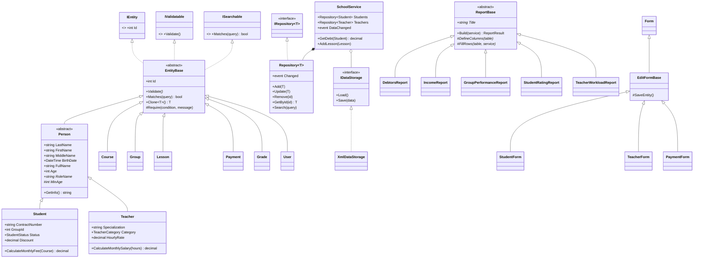

# Автоматизована система приватного навчального закладу

Курсова робота з дисципліни **«Об'єктно-орієнтоване програмування»**.
Настільний застосунок на **C# / Windows Forms** для автоматизації роботи адміністрації
приватного навчального закладу (курси, репетиторський центр, приватна школа).

## Можливості

| Модуль | Що вміє |
|---|---|
| **Авторизація** | Вхід за логіном і паролем (SHA-256 + сіль), обмеження кількості спроб, ролі «Адміністратор» і «Менеджер», зміна користувача без перезапуску |
| **Головна** | Панель показників: кількість учнів/викладачів/груп/курсів, надходження за місяць, загальна заборгованість, кількість боржників, середній бал, розклад на сьогодні |
| **Учні** | Облік учнів (ПІБ, дата народження, договір, група, статус, знижка, контакти батьків). Автоматичний розрахунок місячної оплати та боргу; боржники підсвічуються червоним |
| **Викладачі** | Спеціалізація, освіта, кваліфікаційна категорія, стаж, погодинна ставка; тижневе навантаження |
| **Курси** | Назва, рівень, ціна за місяць, тривалість, кількість занять на тиждень, повна вартість |
| **Групи** | Курс + викладач + аудиторія + кількість місць; контроль наповненості |
| **Розклад** | Щотижневі заняття з **автоматичним контролем накладок** (одна група / один викладач / одна аудиторія не можуть мати два заняття одночасно) |
| **Оплати** | Реєстрація оплат, підказка суми боргу, фільтр за місяцем, сума у вибірці |
| **Успішність** | Журнал оцінок за 12-бальною шкалою, рівні навчальних досягнень, середній бал |
| **Звіти** | Заборгованість, надходження за місяцями, успішність груп, рейтинг учнів, навантаження і зарплата викладачів. Експорт у **CSV** (відкривається в Excel) |
| **Користувачі** | Керування обліковими записами (лише для адміністратора) |

Загальне для всіх списків: пошук, фільтр, сортування кліком по заголовку колонки,
гарячі клавіші (`Insert` — додати, `Enter`/подвійний клік — редагувати, `Delete` — видалити),
експорт поточної таблиці в CSV (`Ctrl+E`).

## Запуск

Потрібно: **Windows**, **Visual Studio 2022** (робоче навантаження «Розробка класичних застосунків .NET») або .NET 8 SDK.

1. Відкрити `PrivateSchool.sln` у Visual Studio.
2. Натиснути **F5**.

Або з командного рядка:

```bash
dotnet run --project PrivateSchool
```

При першому запуску автоматично створюється файл даних `Data\school.xml` (поруч з `.exe`)
із демонстраційними даними: 5 курсів, 5 викладачів, 6 груп, 28 учнів, розклад, оплати й оцінки.
Щоб почати з чистої бази — видаліть цей файл.

**Облікові записи для входу:**

| Логін | Пароль | Роль |
|---|---|---|
| `admin` | `admin123` | Адміністратор (повний доступ) |
| `manager` | `manager123` | Менеджер (без керування користувачами) |

## Структура проєкту

```
PrivateSchool/
├── Models/        — предметна область (класи сутностей, інтерфейси, переліки, виняток валідації)
├── Data/          — зберігання даних: generic-репозиторій, XML-сховище, генератор демо-даних
├── Services/      — бізнес-логіка: SchoolService (фасад), AuthService, PasswordHasher
├── Reports/       — ієрархія звітів (абстрактний ReportBase + 5 конкретних звітів)
├── Controls/      — EntityListControl: універсальний UserControl для списків
├── Forms/         — форми: вхід, головна, базова форма редагування та 8 форм-нащадків
├── Utils/         — допоміжні класи (переліки, ComboBox, CSV-експорт, оформлення таблиць)
└── Program.cs     — точка входу
```

Архітектура трирівнева: **інтерфейс (Forms, Controls) → бізнес-логіка (Services, Reports) → дані (Data, Models)**.
Форми не працюють із файлом напряму — лише через `SchoolService`.

## Діаграма класів (основна частина)



## Реалізація принципів ООП

| Принцип | Де реалізовано |
|---|---|
| **Інкапсуляція** | Приватні поля з властивостями, які нормалізують введення (`Person.LastName` обрізає пробіли, `User.Login` переводить у нижній регістр); пароль зберігається лише як хеш; список у `Repository<T>` закритий, назовні віддається `IReadOnlyList<T>` |
| **Абстракція** | Абстрактні класи `EntityBase`, `Person`, `ReportBase`; інтерфейси `IEntity`, `IValidatable`, `ISearchable`, `IRepository<T>`, `IDataStorage` (сховище можна замінити на JSON чи БД без змін у решті програми) |
| **Наслідування** | `EntityBase → Person → Student / Teacher`; `EntityBase →` `Course`, `Group`, `Lesson`, `Payment`, `Grade`, `User`; `ReportBase →` 5 звітів; **візуальне успадкування форм**: `EditFormBase →` 8 форм редагування |
| **Поліморфізм** | Перевизначення `Validate()` у кожній сутності (`Student` викликає `base.Validate()` і додає власні правила); абстрактні властивості `RoleName`, `MinAge`; віртуальні `GetInfo()`, `Matches()`, `ToString()`; `ReportBase.Build()` — шаблонний метод, що викликає перевизначені `DefineColumns`/`FillRows`/`BuildSummary`; `EditFormBase.SaveEntity()` |
| **Узагальнення (generics)** | `Repository<T> where T : EntityBase`, `EntityBase.Clone<T>()`, `UiHelper.ToDataTable<T>()`, `EnumHelper.GetItems<T>()` |
| **Події та делегати** | `Repository<T>.Changed` → `SchoolService.DataChanged` → автоматичне збереження та оновлення інтерфейсу; події `EntityListControl` (`AddClicked`, `EditClicked`, `DeleteClicked`, `FilterChanged`); `Func<DataRow, Color?>` для підсвічування рядків |
| **Обробка винятків** | Власний виняток `ValidationException`; єдина обробка в `EditFormBase`; глобальний обробник `Application.ThreadException` |

## Бізнес-правила

- Розрахунок оплати: `ціна курсу × (100 % − знижка)`; нарахування — з місяця початку навчання по поточний включно,
  але не більше тривалості курсу. Для учнів в академвідпустці та відрахованих нарахування зупиняється.
- Неповнолітній учень обов'язково має контакт одного з батьків; номер договору унікальний.
- До групи не можна додати учнів понад кількість місць; кількість місць не можна зменшити нижче кількості учнів.
- Розклад: заборонено накладки за групою, викладачем і аудиторією.
- Не можна видалити курс, за яким навчаються групи; викладача, який веде групу; групу, в якій є учні.
  Видалення учня видаляє його оцінки й оплати (з підтвердженням).
- Завжди залишається хоча б один адміністратор; не можна видалити власний обліковий запис.

## Зберігання даних

Усі дані зберігаються в одному XML-файлі (`XmlSerializer`). Після кожної зміни файл перезаписується
через тимчасовий файл, попередня версія зберігається як `school.xml.bak`.
